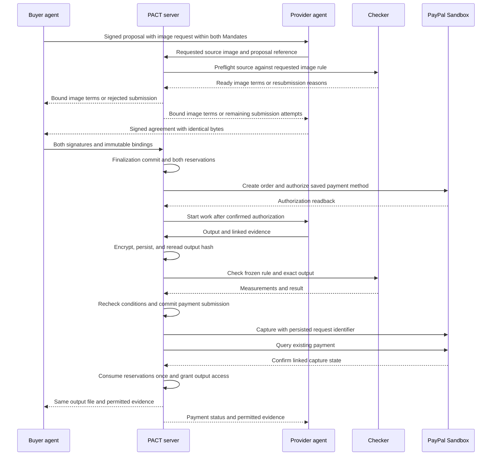

# PACT

PACT connects two bounded Personal Agents, one signed agreement, fulfillment checks, and PayPal payment.
It provides procedural assurance around external payment, not a new payment rail, escrow, or dispute court.

## Adopted design and implementation status

The user authorized GD execution on 2026-10-24.
The [adoption record](docs/feasibility/gd-reconciliation-20261024.md) reconciles this document with the [revision proposal](docs/pact-revision-proposal.md) and ADRs.
The [glossary](GLOSSARY.md) defines project terms.
The proposal specifies detailed requirements that this document summarizes.
These requirements describe the target implementation, not completed features.

The scope permits one buyer, one provider, one linked merchant, JPY, and one image.
One integer amount unit represents one yen.
The implementation uses one server, SQLite write transactions, and one payment worker.
Local feasibility code and bounded Sandbox experiments exist.
G1 passed review within the [accepted bounded Sandbox scope](docs/feasibility/g1-acceptance-20261024.md).
Independent G2 evaluation remains unresolved.
G3 implementation requires reviewed G1, G2, and GD success.
Current evidence appears in the [closure plan](docs/feasibility/g1-closure-plan-20261024.md).

## Problem and claim limits

The customer hypothesis concerns small merchants who repeatedly outsource product images to an independent provider.
PACT aims to let Principals specify conditions before their Personal Agents arrange and execute commerce within prior user limits.
The primary value comparison measures human work against human-operated transactions.
The [G5 clarification](docs/feasibility/g5-delegated-commerce-20261025.md) separates this benefit from additional AI contribution.
This hypothesis remains unvalidated.
Direct model calls, human inspection, and deterministic automatic payment remain comparison flows.
The proposal defines sampling, fair comparison, rejection thresholds, setup costs, time, and total costs.
PACT does not claim other protocols support only buyers or lack delegation and signed payment evidence.
Negotiation superiority and interoperability remain unverified.

## Participants and authority

| Actor | Responsibility |
| --- | --- |
| Buyer Principal | Issue the buyer Mandate and consent to the saved payment method. |
| Buyer Personal Agent | Propose and sign terms within that Mandate. |
| Provider Principal | Issue the provider Mandate and register the fixed merchant. |
| Provider Personal Agent | Negotiate, perform work, and submit the output and evidence. |
| PACT server | Validate authority, order records, reserve limits, control files, and orchestrate PayPal calls. |
| Fulfillment checker | Evaluate the frozen deterministic rule without deciding disputes. |
| PayPal | Authorize and capture payment and decide disputes within its authority. |

User and agent signing keys remain separate.
User private keys remain on user devices.
The server authenticates browser-bound, purpose-bound, signed challenges with one-use nonces and five-minute expiry.
The server derives the Principal from its verified key registration.
HTTPS sessions use HttpOnly, Secure, and SameSite cookies with request forgery protection for state changes.
Account changes require a current session and a new action-bound user signature.
PayPal consent callbacks require a matching session and one-use state value.

The account binding version links the buyer Principal to server-obtained buyer and token identities.
Merchant registration links the provider Principal to the fixed merchant identity.
Agents cannot supply arbitrary payment tokens or substitute merchants.
Finalization and payment submission validate both ownership bindings and both delegated signing keys.
The server checks object permissions before disclosure, state changes, or external calls.
Support operators cannot download files, change account bindings, or create payments.
Proposal section 4 specifies the complete permission matrix.

## Signed records and trust

Each Mandate binds user and agent keys, permitted roles, counterparties, tasks, transaction and period limits, duration, expiry, and revocation identifier.
Both agents sign the same canonical agreement bytes.
The agreement binds transaction ID, both Mandates, roles, integer JPY amount, obligations, account version, and merchant.
It also binds image request hash, input hash, rule hash and version, dimensions, region counts, and deadlines.
It binds rework, cancellation, refund, delivery, and retention conditions.
Signed proposals link to their previous proposal hashes.
Output and checker records bind the agreement hash, submission number, file hashes, checker version, measurements, and time.
Payment records bind the same agreement, accepted output, account version, merchant, amount, currency, and distinct request identifiers.
The validator treats AI output as untrusted input.
It checks types, ranges, signatures, times, file sizes, and permissions at input boundaries.

Both parties can independently verify signatures and hashes on their permitted evidence copies.
The server remains trusted for account bindings, file custody, and authenticated PayPal readback assertions.
A server signature proves the server made an assertion.
It does not prove PayPal signed the agreement or prevent consistent server lies.
Signed receipts and minimal public summaries support comparison against retained copies.
This single-server record provides no distributed consensus, availability guarantee, or collusion resistance.

## Transaction flow

The runtime command `pact.server trade` connects source exchange, negotiation, and the existing worker for one prepared transaction.
The operator supplies complete permitted candidates and valid Mandates before execution.
The command performs at most one rework when the signed conditions permit it.
The separate `negotiate` command remains payment-free.
Uncertain execution requires inspection and recovery of the same finalized transaction through `work`.
This command does not change consent, payment limits, or gate acceptance.

### Finalization, revocation, and limits

Both signatures are prerequisites, not finalization.
The finalization commit validates both Mandates, revocation, expiry, stop state, and limits in one SQLite write transaction.
It reserves both original period limits and records the agreement and sequence atomically.
Revocation and finalization use the same write order.
Revocation committed first rejects finalization.
Finalization committed first preserves that agreement despite later revocation.
Unavailable ordering state prevents finalization.

Each period requires consumed amount plus reserved amount plus the new amount at or below its limit.
Two concurrent JPY 6 agreements against a JPY 10 limit must finalize exactly one agreement.
Failure on either side leaves neither reservation.
Reservations remain in their original periods after period boundaries.
Confirmed capture moves reservations to consumption exactly once.
Unknown payment results retain reservations.
Release requires confirmed nonpayment and impossibility of payment through the existing path.
Local timeout or deadline expiry alone does not establish those conditions.
Refunds do not automatically restore period consumption.

### Payment submission, stop, and recovery

The worker persists immutable payloads and distinct step request identifiers before order creation, authorization, and capture.
The payment submission commit rechecks stop, deadline, accepted output, account ownership, and delegated authority in one write transaction.
A stop committed first prevents payment submission and transmission.
A payment submission commit recorded first fixes that payment intent, even before HTTP transmission.
Later stop or agreement deadline expiry does not cancel that existing intent.
Other new payment intents and evidence submissions remain prohibited.
The interface explains this boundary and shows current payment status.
A remaining authorization without committed payment submission enters verified cancellation handling.

Recovery queries known external identifiers first.
A supported retry uses the existing job, request identifier, and immutable payload within G1-confirmed endpoint conditions.
Recovery never substitutes a new order, authorization, account binding, or request identifier to bypass uncertainty.
Missing identifiers, expired idempotency retention, `PENDING`, or conflicting evidence preserve unknown payment state unless supported recovery establishes an outcome.
External authorization expiry differs from the agreement deadline.
The worker queries existing payment state before treating authorization expiry as terminal failure.
Repeated agreement submissions return existing state without an additional payment flow.

The user sees reserved amounts, unresolved reason, last verification, support owner, and next verification time.
An authenticated support operator can record linked official account or PayPal support evidence under proposal section 6.
The state handler validates evidence, bindings, and allowed transitions before changing state and reservations together.
Screenshots, balance changes, or missing search results alone cannot close the case.
Insufficient or conflicting evidence preserves unknown state and reservations.
The audit records actor, time, source, evidence hash, reason, and previous and resulting states.
The initial support acknowledgement target is one business day, not a resolution or PayPal timing guarantee.

## Supported work and independent checker evaluation

The [negotiated image amendment](docs/feasibility/negotiated-image-contract-20261024.md) defines the adopted image service.
The buyer agent sends a versioned request with dimensions, background RGB, and the complete fixed rule.
The provider agent submits a source image or proposes supported alternatives within both Mandates.
The server performs preflight before agreement, reservations, or payment authorization.
The server records up to three source submissions under the same negotiation identity.
A successful preflight binds request, source, rule, dimensions, and region counts into the final agreement.
Three failures close the negotiation without payment.

The raster rule removes perimeter-connected pixels near the requested background color and preserves every other pixel exactly.
The rule rejects ambiguous colors, enclosed background regions, disconnected preserved regions, and unsupported formats.
It does not identify products, remove every shadow, or certify photographic quality.
OpenCV generates the output without pretrained models.
A separate deterministic traversal checks every output pixel without trusting provider masks.

G2 retains ten calibration originals and twenty independent evaluation originals after a fresh freeze.
Independent raster references replace semantic product masks under the new contract.
The evaluator must not derive reference regions from production checker or generator results.
The target accepts at least eighteen valid outputs and rejects all 140 attacks and every declared unsupported case.
The evaluator retains every first-run result and distinguishes photographs from synthetic cases.
Rule or scope changes require fresh independent evaluation data.
Local synthetic tests and previous semantic experiments do not establish G2 success.

The normal negotiation permits at most three proposals.
An agreement can permit one rework within its deadline after checker failure.
A second failure or unverifiable result starts cancellation handling without capture.
Per-transaction human approval cannot bypass checker failure.
Authorization must be confirmed before work, but does not guarantee payment success or cover provider work costs.

## Delivery, evidence, and disputes

Before capture, the server encrypts and durably stores the immutable output under its hash.
It reads the stored file again and verifies the hash.
Storage failure prevents payment submission.
The buyer cannot download the original result before confirmed payment.
Confirmed payment grants access to the same output hash.
Restart after payment but before access persistence must recover access through payment readback without another payment.
Delivery retry uses the same paid file and creates no additional payment.
Permanent file loss remains unresolved and exposes support and evidence export instead of a delivery success claim.
Host-loss backup remains outside scope.

The server encryption key remains separate from database, file storage, repository, user signing keys, and user backup keys.
The server process can decrypt files, so host administrator confidentiality is not guaranteed.
Both parties receive permitted evidence without payment secrets or the other party's private account data.
Public summaries contain no original files or payment secrets.
Retention follows the agreed end date and applicable obligations.
Disputes, unknown payments, and objections suspend related evidence deletion.
Optional user backup uses the user's separate encryption key and remains outside the core demonstration path.

The demonstration exports evidence only.
Disputes API submission requires separate dispute authority and verified account capability outside this implementation scope.
PACT does not decide disputes, guarantee a favorable outcome, or promise automatic refunds.

## User interface and AI contribution

One transaction detail view shows stage, price, remaining limit, payment status, and next actions.
Application notifications require no transaction approval.
Expandable evidence shows agreement and Mandates, output and checker results, then payment readback and downloaded file hashes.
The transaction ID stays visible throughout.
Email integration remains outside scope.

AI proposes bounded prices, deadlines, and compatible image submission conditions.
It structures terms and explains evidence from recorded facts.
OpenCV performs the agreed raster operation.
Deterministic code validates authority and payment conditions.
The system does not store hidden model reasoning as evidence.
It stores input references, rule and model versions, structured results, confidence, and a short reason.
A fair deterministic comparator receives the same constraints, candidates, checker, payment, and recovery infrastructure.
If that comparator performs equally, PACT cannot claim negotiation superiority.
Equal automated performance does not disprove reduced human work against human-operated commerce.
The proposal defines the exact comparison and customer validation protocol.

The planned 2:45 video includes consent evidence, unattended transaction, damaged-output rejection, recovery, replay prevention, and evidence export.
Actual timing and the complete integrated demonstration remain unverified.
The presentation must distinguish plans, local tests, actual Sandbox observations, and unresolved conditions.

## Implementation sequence and exclusions

1. Complete reviewed G1 payment evidence under the declared conditions.
2. Complete independent G2 checker evaluation under the frozen protocol.
3. Record GD adoption and document consistency.
4. Implement and verify G3 transaction safety after those conditions hold.
5. Verify G4 failure flows, restart recovery, and delivery access.
6. Measure G5 customer applicability, costs, intervention, and negotiation value.

Marketplace, multiple merchants, general task rules, partial payments, long tasks, and automated dispute submission remain outside scope.
Key recovery and user backup remain documented future capabilities outside the core demonstration path.
Document adoption does not prove successful implementation, customer value, production eligibility, or submission readiness.
Language review scope and exceptions appear in the GD adoption record.
