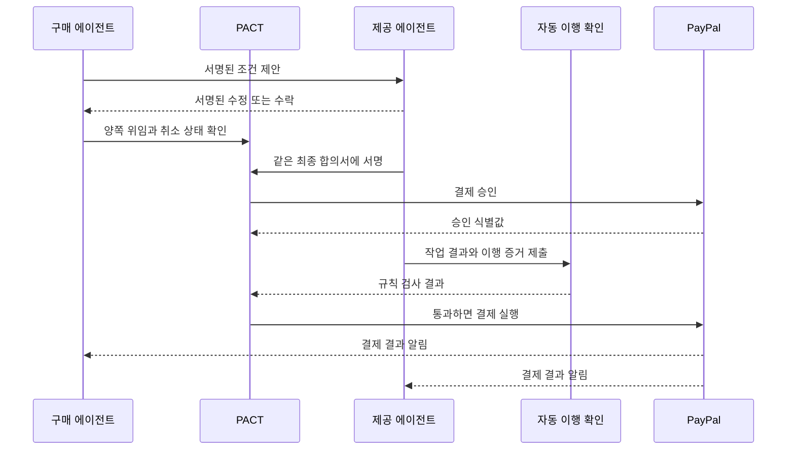

# PACT

> 두 사용자의 에이전트가 같은 조건에 서명하고, 이행 증거를 확인한 뒤 PayPal로 자동 결제하게 하는 상호 보증 규칙

## 목표

에이전트가 물건과 서비스를 서로 사고파는 시대에는 결제 버튼보다 먼저 풀어야 할 문제가 있다.

- 이 에이전트가 사용자의 허락을 받았는가?
- 두 에이전트가 같은 조건에 합의했는가?
- 합의 뒤 조건이 바뀌지 않았는가?
- 약속한 일이 끝났는가?
- 같은 요청이 두 번 결제되지 않는가?
- 문제가 생기면 무엇을 증거로 낼 수 있는가?

PACT는 이 질문에 답하는 상호 보증 계층이다. PACT는 새 결제망, 에스크로 또는 분쟁 법원이 아니다. 실제 결제와 결제 후 분쟁 처리는 PayPal이 맡는다.

## 핵심 차이

일반 결제 에이전트는 한 사용자의 구매 권한을 확인한다. PACT는 거래 양쪽 사용자의 에이전트를 같은 규칙으로 확인한다. 양쪽은 서로의 위임 범위, 제안, 최종 합의와 이행 증거를 독립적으로 검증한다.

사용자는 처음에 거래 한도와 허용 범위를 정한다. 그 뒤에는 협상, 합의, 이행 확인과 결제가 사람의 추가 클릭 없이 진행된다. 사용자는 주요 사건을 즉시 통보받고 언제든 새 거래를 멈출 수 있다.

## 참여자

| 참여자 | 역할 |
| --- | --- |
| 구매 사용자 | 금액, 기간, 거래 종류와 상대방 범위를 위임한다. |
| 구매 에이전트 | 위임 범위 안에서 조건을 협상하고 결제 승인을 요청한다. |
| 제공 사용자 | 작업 종류, 최소 금액과 이행 조건을 위임한다. |
| 제공 에이전트 | 조건을 협상하고 작업과 증거를 제출한다. |
| PACT 서비스 | 서명된 기록을 전달하고 순서를 기록하며 PayPal 호출을 연결한다. 기록 내용의 유일한 신뢰 근거는 아니다. |
| 자동 이행 확인 도구 | 합의된 규칙으로 제출물을 검사한다. 분쟁의 승패는 판단하지 않는다. |
| PayPal | 결제를 승인하고 실행한다. 결제 후 PayPal 분쟁을 판단한다. |

## 거래 자료

PACT 거래는 다음 자료를 사용한다.

1. **위임장**: 에이전트 공개 열쇠, 거래별 한도, 기간 총한도, 허용 거래 종류, 만료일과 선택한 상대방 제한
2. **제안 기록**: 이전 제안 확인값을 포함한 서명된 가격과 조건 변경 기록
3. **최종 거래 합의서**: 역할, 금액, 통화, 의무, 완료 기준, 기한, 취소·환불 조건, 규칙서 판과 양쪽 위임장 식별값
4. **이행 증거**: 입력과 출력 확인값, 검사 결과, 시각, 사용한 규칙과 필요한 최소 자료
5. **결제 기록**: PACT 거래 번호에 연결한 PayPal 주문, 승인, 결제와 분쟁 식별값
6. **공개 기록**: 원문을 제외한 확인값, 기록 종류, 서명자, 순서와 시각

두 에이전트는 같은 서명 자료와 기록 영수증을 보관한다. 어느 한 서버가 기록을 바꾸거나 지워도 상대방 사본과 공개 요약으로 이를 찾을 수 있다.

## 거래 흐름

각 단계는 다음 규칙을 지킨다.

- 최종 합의 직전에 두 위임장이 아직 유효한지 확인한다.
- 공개 기록 순서상 위임 취소가 먼저면 새 합의를 만들지 않는다.
- 결제 승인에 실패하면 이행을 시작하지 않는다.
- 자동 확인에 실패하거나 확인할 수 없으면 결제를 실행하지 않는다.
- 같은 거래 번호의 재시도는 이전 결과를 돌려준다. 새 결제를 만들지 않는다.
- 결제 승인은 지급 보장이 아니다. 승인 뒤에도 PayPal의 위험 검사나 자금 상태로 결제가 실패할 수 있다.

## 해커톤 시연

### 상황

사용자 A의 구매 에이전트가 사용자 B의 작업 에이전트에 상품 사진 배경 제거를 맡긴다.

1. 구매 에이전트가 가격, 파일 형식, 크기, 기한과 사용 권리를 제안한다.
2. 제공 에이전트가 조건을 수정하거나 수락한다.
3. 두 에이전트가 같은 최종 합의서에 서명한다.
4. PACT가 PayPal 결제 승인을 받는다.
5. 제공 에이전트가 배경을 제거하고 PNG 파일을 제출한다.
6. 고정된 검사기가 크기, 형식, 투명 영역, 입력·출력 연결과 전경 보존 기준을 확인한다.
7. 통과하면 PACT가 PayPal 결제를 실행한다.
8. 같은 합의서를 다시 보내면 중복 결제가 막히고 그 사건이 기록된다.

검사 통과는 약속한 파일 조건을 만족했다는 뜻이다. 미적 품질이나 완벽한 배경 제거를 보증한다는 뜻은 아니다.

### 화면 구성

- 왼쪽: 구매 사용자와 구매 에이전트
- 오른쪽: 제공 사용자와 제공 에이전트
- 가운데: 합의서 확인값, 단계별 증거와 PayPal 상태

시연 전에 한 번만 위임장과 PayPal 결제수단 권한을 보여 준다. 실제 시연에서는 협상부터 결제까지 사람의 클릭을 넣지 않는다.

### 3분 영상 구성

| 시간 | 내용 |
| --- | --- |
| 0:00~0:25 | 에이전트끼리 거래할 때 생기는 권한, 조건 변경과 증거 문제 |
| 0:25~0:45 | 양쪽 사용자의 제한된 위임장과 한 번의 PayPal 권한 설정 |
| 0:45~1:25 | 두 에이전트의 자동 협상과 같은 조건 서명 |
| 1:25~2:05 | PayPal 승인, 배경 제거, 자동 이행 확인과 결제 실행 |
| 2:05~2:30 | 같은 거래 재사용 공격 차단과 양쪽 증거 묶음 |
| 2:30~2:50 | 결제 후 분쟁에서 PayPal에 제출할 증거 연결 |
| 2:50~3:00 | PACT 한 문장 설명과 확장 가능성 |

## AI와 PayPal의 역할

AI는 다음 일에 사용한다.

- 두 위임 범위 안에서 가격과 조건을 협상한다.
- 대화에서 합의 항목을 구조화하고 빠진 조건을 찾는다.
- 배경 제거 작업을 수행한다.
- 분쟁이 생기면 필요한 자료를 거래 기록에서 찾고 설명을 만든다.

일반 코드는 금액, 통화, 한도, 서명, 만료, 기록 순서, 중복 요청과 자동 완료 기준을 검사한다. AI의 숨은 추론 내용은 증거로 저장하지 않는다. 입력 자료의 참조, 사용한 규칙과 모델 판, 구조화한 결과, 확신도와 짧은 근거만 저장한다.

PayPal은 다음 일에 사용한다.

- 사용자의 최초 결제수단 권한 설정
- Orders와 Payments를 통한 승인과 결제 실행
- 결제와 분쟁 식별값 제공
- 결제 후 PayPal 분쟁 판단

최초 권한 설정 뒤 사람의 추가 승인 없이 후속 결제를 실행할 수 있는 정확한 sandbox 방식과 계정 권한은 구현 전에 확인해야 한다.

## 증거와 분쟁

PACT는 누가 어떤 권한으로 어떤 조건에 서명했고 무엇을 제출했는지 증명한다. 서비스 품질, 상품 진위, 법적 효력 또는 사기가 없다는 사실까지 증명하지 않는다.

결제 후 분쟁이 생기면 PACT가 승패를 판단하지 않는다. 별도의 분쟁 대응 위임장이 있을 때만 필요한 증거를 PayPal에 제출한다. PayPal 내부 분쟁은 PayPal이 판단한다. 카드 결제 취소처럼 외부 금융기관이 다루는 사건은 해당 기관이 판단할 수 있다.

거래 자료는 정해진 보관 종료일까지 보관한다. 분쟁 중에는 삭제를 멈춘다. 원본 대화와 파일은 암호화해 각 사용자 쪽에 보관하고 필요한 자료만 공개한다. 사용자는 자기 자료를 선택한 저장소에 암호화해 백업할 수 있다.

## 주요 위험과 대응

| 위험 | 대응 | 남는 한계 |
| --- | --- | --- |
| 에이전트가 권한을 넘음 | 양쪽이 최종 합의 전 위임 한도와 취소 기록을 확인 | 사용자 위임 자체가 너무 넓으면 손실 가능 |
| 같은 거래를 다시 보냄 | 거래 번호 하나를 PayPal 결제 흐름 하나에 묶음 | 외부 시스템이 거래 번호를 무시하면 별도 방어 필요 |
| 기록을 바꾸거나 지움 | 양쪽 서명 사본, 연결된 확인값, 서명 영수증과 공개 요약 | 공개 기록 서비스가 멈추면 새 합의를 중단해야 함 |
| 자동 검사를 속임 | 거래 종류별 고정 규칙과 최소 증거 사용 | 미적 품질과 외부 사실은 완전히 확인할 수 없음 |
| 작업 뒤 결제가 실패함 | 승인 직후 짧은 작업만 시연하고 확인 즉시 결제 실행 | PayPal 승인은 지급을 보장하지 않음 |
| 서명 열쇠가 탈취됨 | 사용자 열쇠와 에이전트 열쇠 분리, 취소, 긴급 정지, 복구 열쇠 | 정지 전 확정된 거래는 자동으로 사라지지 않음 |
| 결제 후 분쟁이 생김 | PayPal 식별값과 거래 증거를 연결해 필요한 자료 제출 | 최종 판단은 PACT가 통제하지 않음 |

## 최소 구현 범위

만드는 것:

- 두 사용자의 제한된 위임장 생성과 취소 확인
- 두 에이전트의 조건 제안과 같은 합의서 서명
- 배경 제거 거래 규칙서 한 종류
- PayPal sandbox 승인과 결제 실행 한 흐름
- 자동 이행 확인과 중복 결제 차단
- 양쪽 거래 증거 묶음과 간단한 사건 화면

만들지 않는 것:

- 범용 에이전트 장터
- 새 화폐, 블록체인 또는 에스크로
- 여러 거래 종류의 실제 구현
- 사람 대신 분쟁 결과를 정하는 기능
- 주관적 품질을 자동으로 보증하는 기능
- 장기간 또는 여러 단계로 나눈 작업

프로토콜 문서는 여러 거래 종류로 확장할 수 있게 쓰되, 시연 코드는 배경 제거 한 종류만 구현한다.

## 성공 기준

- 양쪽 에이전트가 사람의 추가 클릭 없이 한 거래를 끝낸다.
- 서로 다른 조건에 서명하려는 시도를 막는다.
- 취소되거나 한도를 넘은 위임으로 새 거래를 만들지 못한다.
- 완료 조건을 통과한 거래만 PayPal 결제를 실행한다.
- 같은 거래를 다시 보내도 결제가 한 번만 발생한다.
- 양쪽 증거 묶음으로 위임, 합의, 이행과 PayPal 식별값을 연결해 확인할 수 있다.

## 구현 전 확인할 항목

1. 선택한 PayPal sandbox 앱에서 저장된 결제수단을 이용한 후속 무인 결제가 가능한가?
2. 결제 승인과 실행 흐름을 한 판매자 sandbox 계정에서 재현할 수 있는가?
3. 시연 계정에서 Disputes API와 증거 제출을 어디까지 보여 줄 수 있는가?
4. 배경 제거 검사 규칙이 정상 파일과 잘못된 파일을 안정적으로 구분하는가?
5. 3분 영상에서 한 번의 권한 설정과 무인 거래의 차이가 명확하게 보이는가?
